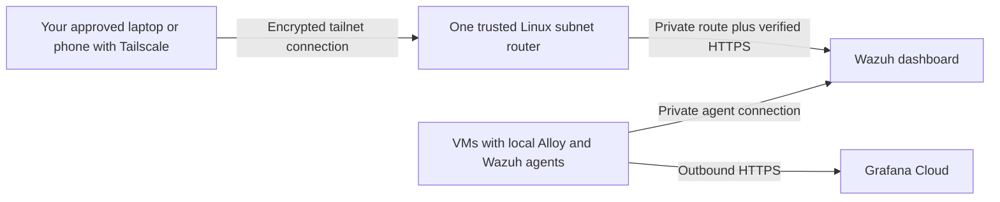

# Private access and network security

HTTPS authenticates a server and encrypts traffic. It does not prevent someone
from exhausting a public service or its internet connection. Keep the local
monitoring system private, and restrict each service to its actual clients.

**Status:** this is the required network policy and verification guide. The current
Terraform monitoring root deploys applications/configuration but does not install a
VPN or change host firewalls, OPNsense rules, NAT, UPnP or IPv6 exposure. No live
network isolation has been verified. Do not interpret an approval flag as a firewall
rule. Network automation needs the actual interfaces, subnets, management path and
existing rule inventory before it can safely be implemented through Terraform.

## Wazuh stays private

Use an existing management network and, for remote access, an authenticated VPN.
Give the dashboard access only to your administrator devices. Give monitored
endpoints access to the agent listener, without giving them dashboard, API or
indexer access. In particular, isolate malware/pentest guests from management.

Use exact address aliases or authenticated VPN identities when possible rather
than allowing an entire home LAN. A private address alone does not enforce this.
Local machines on the same subnet can bypass a router's inter-VLAN rules, so also
use the Wazuh host firewall or actual network segmentation. Apply the same policy
to IPv4 and IPv6. Avoid public port forwards and automatic UPnP/NAT-PMP mappings
for these services.

The table describes the pinned Wazuh **4.x all-in-one** design. Read back actual
listeners/configuration first; custom ports or a distributed layout need a reviewed
adjustment. Rules are stateful; allow return traffic for established connections.

| Destination | Allowed initiators | Intended policy |
| --- | --- | --- |
| Wazuh dashboard TCP 443 | Explicit administrator devices through management LAN/VPN | Deny all other sources, including WAN and lab guests. |
| Wazuh events TCP 1514 | Explicit monitored endpoint addresses through private routes/VPN | Deny all other sources. |
| Enrollment TCP 1515 | Only endpoints currently being enrolled | Open narrowly for enrollment, then remove the allowance when no longer needed; deliberate reenrollment needs it again. |
| Wazuh API TCP 55000 and indexer TCP 9200 | Same-host central components; narrowly approved maintenance controller if required | No general LAN, agent or WAN access. A loopback bind is preferred where compatible with existing configuration/certificates. |
| Cluster ports TCP 1516 and 9300–9400 | None for this single-node deployment | No remote access. Distributed deployments require their own policy. |
| Optional syslog TCP 514 or TLS relay TCP 6514 | Exact approved firewall/device source over the verified protected path | Disabled unless needed; no WAN access. Native Wazuh TCP syslog is plaintext and needs the documented encrypted VPN path. |
| Wazuh host SSH TCP 22 | Exact trusted deployment/admin devices through management LAN/VPN | Verified host keys and key-based authentication; no general WAN or lab access. |
| Alloy management TCP 12345 and optional container syslog TCP 1515 | Localhost only, on each collector host | No network-facing management/exporter ports. The container syslog port is local to that collector, distinct from Wazuh enrollment on the manager. |

Do not apply a blanket default-deny host policy over your only SSH connection.
Before any automated firewall change, preserve a verified management rule and
console access, inspect the Terraform plan and use a tested rollback method.
This is a deployment prerequisite, not permission to remove existing rules.

## One Tailscale device can provide remote access

The XOA-specific Tailscale endpoint is declared separately in the
[XOA remote-access workflow](../../xen-server/remote-access.md). It provides XOA
web/SSH access and does not advertise monitoring or home-LAN subnet routes. A
[Tailscale subnet router](https://tailscale.com/docs/features/subnet-routers)
can run on one existing trusted Linux VM and route approved remote administrator
devices to selected services. Other destination VMs do not need Tailscale. This
is a network gateway, distinct from a metrics exporter or log collector.
Subnet routers and basic source/destination/port access rules are available on
all plans. Verify this account is actually on the free Personal plan and within
its applicable limits before deployment; no paid upgrade is authorized.

If Wazuh is the only private service you need remotely, installing Tailscale on
the Wazuh VM itself is simpler: no subnet router or routes to other machines are
needed. A separate subnet router becomes useful when you want access to several
private services without installing Tailscale on each destination. Use a trusted
management VM, never the hypervisor dom0 or a malware/pentest guest.

For the subnet-router option:

1. Inventory the actual management interfaces, Wazuh address, existing routes,
   host firewall and tailnet policy. Choose an existing always-on Linux host with
   a management path and console recovery. Do not provision a cloud VM for this.
2. Advertise only required destinations, preferably individual service-host `/32`
   routes where suitable, rather than automatically sharing the whole LAN. Route
   approval and access permission are separate requirements.
3. Review the full existing tailnet policy and grant only approved admin devices
   access to the exact destination and dashboard/management ports. Adding a narrow
   rule while retaining a broader allow-all rule does not restrict access.
   Tailscale's initial policy can allow all tailnet devices to communicate.
   Use policy tests to verify allowed admin access and denied unrelated devices.
   Preserve other deliberately authorized users/services when reviewing policy.
4. Enforce corresponding host/VLAN rules on the private network. Tailscale access
   rules do not control traffic that bypasses Tailscale on the local LAN.
   Subnet routing uses SNAT by default, so the Wazuh host normally sees the
   router's private address. Enforce individual remote-device authorization in
   Tailscale and allow the router address only the necessary destination ports
   at the host firewall; do not assume the host sees each client's identity.
5. Keep HTTPS certificate verification on the final hop. The encrypted tailnet
   connection ends at the subnet router. Plain syslog from there across a LAN
   is still plain syslog; this arrangement alone does not satisfy the existing
   end-to-end encrypted-syslog verification gates.
6. Verify actual account eligibility and limits, advertise/approve routes and
   apply reviewed access rules through a separate Terraform-managed network
   addition once topology and current policy are known. Keep device enrollment
   keys out of source, plans/state and command history. No Tailscale auth key,
   network change or tailnet-wide policy replacement has been created here.

One router is a single point of failure: if it is offline, remote management
stops. Local VM-to-Wazuh collection and outbound Grafana collection can continue
without it. Every monitored VM still needs its own supported Alloy/Wazuh agents
for local OS logs and endpoint security events; a router cannot collect those
automatically. Appliance metrics can use separate agentless collection where
supported, which remains pending for unverified devices in this repository.

See [Tailscale access controls](https://tailscale.com/docs/features/access-control/acls)
and [current Personal-plan terms](https://tailscale.com/pricing).

## If services later run in Oracle Cloud

An encrypted home-to-Oracle connection is useful when a service actually runs in
Oracle. It is unnecessary for local Wazuh plus outbound Grafana Cloud collection.
The owner selected Oracle Wazuh. The separate [Oracle root](../../infra/oracle/wazuh/README.md)
now prepares that VM/network and an explicit external inventory alias; no workload
has been created because free ARM host capacity was unavailable at the last check.
The captured local VM remains recovery evidence, and private VPN configuration
is a separate uncompleted rollout requirement.

| Option | Suitable use | Cost and access boundary |
| --- | --- | --- |
| Tailscale on one home gateway and on the Oracle service VM | A small number of private cloud services | Uses existing free-plan eligibility and only an independently verified Always Free VM. Home VMs can route through the gateway; each does not need Tailscale. Limit routes and grants to exact services. |
| OPNsense IPsec to OCI Site-to-Site VPN/DRG | Several Oracle private subnets and a more involved network | Oracle lists the VPN service itself as free; applicable data transfer and all associated resources still need account-specific $0 verification. Needs reviewed CPE address, routing, nonoverlapping subnets and firewall rules. |
| OCI FastConnect | Dedicated private connectivity | Port fees and potentially provider/circuit charges make this outside the repository's $0 scope. Do not provision it. |

Tailscale and IPsec provide encrypted connections over internet transport; they
are not dedicated private circuits. Restrict both directions: Oracle workloads
must not receive broad access to home management or malware/pentest networks.
On Oracle, retain exact network security-group/security-list rules and guest
firewall restrictions. Do not publicly open Wazuh dashboard, enrollment, API or
indexer ports to make the tunnel easier to configure. A public VM address alone
does not require those application ports to be public.

For a single Oracle Wazuh VM, a home subnet router plus Tailscale directly on the
cloud VM is the smaller design to evaluate first. A home gateway does not
automatically make every home-to-cloud flow use the tunnel: routes, return paths,
source identity/SNAT and access tests must be configured. Oracle infrastructure is authorized only under the absolute $0 checks. No live
network change or Tailscale enrollment has been performed.

Before implementation verify tenancy-wide free eligibility, total usage and
network/data-transfer limits again. A VPN being free does not make every resource
behind it free. Keep FastConnect, paid NAT/load balancers, public fallback services
and account upgrades out of the plan. Sources:
[Oracle networking pricing](https://www.oracle.com/cloud/networking/virtual-cloud-network/pricing/),
[OCI IPsec setup requirements](https://docs.oracle.com/en-us/iaas/Content/Network/Tasks/settingupIPsec.htm).

## Grafana Cloud uses outbound collection

Alloy initiates HTTPS connections to the existing hosted metrics/logs endpoints.
Grafana Cloud does not need an inbound connection to the Wazuh host, its APIs,
collectors or home router for this design. Do not open WAN ports for Grafana to
scrape your hosts. The existing cloud dashboard remains a Grafana-hosted public
endpoint protected by account authentication; a local VPN does not make its
original URL private.

Enable Grafana account MFA, review stack membership and disable anonymous
access, externally shared dashboards and public snapshots unless explicitly
intended. Use a stack-scoped ingestion policy with only `metrics:write` and
`logs:write`, separate from the dashboard-management service-account token.
Where supported by the stack's actual endpoint, the
[Cloud access-policy IP restriction](https://grafana.com/docs/grafana-cloud/platform/security-and-account-management/security-and-access/authentication-and-permissions/access-policies/ip-ranges-access-policies/)
can additionally limit use of that ingestion token to your public egress IP
(`/32` for one IPv4 address, `/128` for one IPv6 address). Check support without
enabling a paid feature. A changing ISP address requires a reviewed update;
otherwise ingestion will stop. This policy is enforced during token validation,
not before traffic reaches Grafana, and does not make the browser login page
private or provide DDoS immunity. The current Terraform root does not manage Cloud
access policies or create their tokens.

Do not place a proxy in front of the hosted dashboard and assume the original
Grafana URL is inaccessible. Verify actual hosted UI restrictions before claiming
only your devices can reach it; no Free-plan private UI control has been verified
for this account.

## What remains possible during a denial-of-service attack

Someone on the public internet cannot directly reach a correctly isolated Wazuh
application. A compromised allowed endpoint can still flood its listener or send
excessive logs. Exact source rules, separate lab networks, conservative collection,
disk/CPU monitoring and source revocation reduce that risk. A stolen ingestion
token can permit unwanted writes; scoped permissions, rotation and supported IP
conditions reduce its reach.

A sufficiently large attack on your home public IP can still saturate the ISP
link even if every application port is closed or access requires a VPN. A local
firewall cannot recover bandwidth consumed upstream; mitigation then requires
the ISP or upstream provider. VPNs, rate limits and MFA do not guarantee
availability. Grafana operates its hosted network; this repository cannot promise
its resistance to a targeted attack or a service outage.

## Verify the policy before enabling collection

1. Inspect `sudo ss -lntup` on the Wazuh Linux VM. Confirm listener bindings and
   compare with the actual host firewall and router rules; a listening socket
   alone is not proof of internet exposure or isolation.
2. From an allowed admin device, confirm dashboard and SSH access. From an
   allowed monitored endpoint, confirm only its required listener is reachable.
3. From a lab guest and an unauthorized LAN device you control, verify dashboard,
   SSH, API and indexer connections are blocked. Test same-subnet access too.
4. From outside your network, test only your own public addresses and confirm
   there is no Wazuh/NAT exposure. Check both public IPv4 and IPv6, including
   temporary IPv6 addresses and any existing cloud security rules.
5. Verify VPN identities and access rules. Stop the VPN in a controlled test and
   confirm protected syslog cannot fall back to a plain route. Verify certificate
   chain, name and expiry without skipping certificate checks.
6. Confirm normal ingestion and alerts resume after testing. Record the verified
   sources, time and policy privately; enable deployment flags only for that
   verified setup.

Official port reference: [Wazuh architecture](https://documentation.wazuh.com/current/getting-started/architecture.html).
